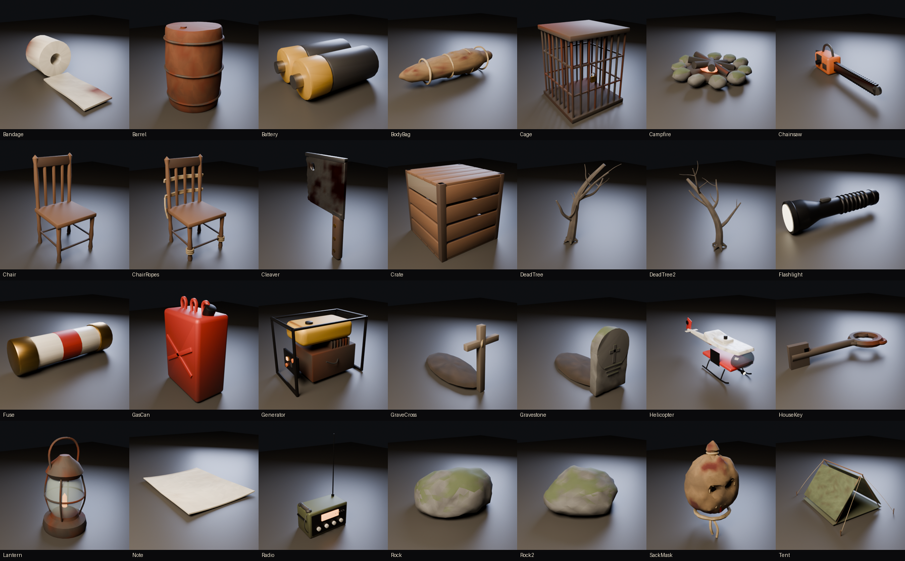

# Butcher's Hollow

A first-person survival horror game for Roblox. Your car crashes on a forest road at night. You wake up tied to a chair in a cannibal family's farmhouse and watch them butcher the last traveller. Then you cut yourself free, escape the house, rebuild a broken-down truck in the woods, steal the keys off the Butcher's belt, and run for the ranger station when the engine blows.



## The story

| Chapter | What happens |
| --- | --- |
| **Prologue: Hollow Road** | Cutscene: night drive in the rain, a figure in the headlights, the crash, being dragged to the house. |
| **I: The Butcher's House** | Cutscene: you wake tied up while the Butcher and Brother Abel carve up a body, then saw through the ropes with the knife beside you. Find a flashlight, find the padlock key upstairs, and escape through the chained front door while they patrol both floors. |
| **II: The Woods** | Find the abandoned pickup. Its parts are scattered through the forest: the **engine** in the old barn, the **battery** at the hunter's camp, the **spark plugs** in the doctor's trailer, the **spare wheel** in the cemetery. Find **sedative syringes**, sneak up behind the Butcher, inject him and take the **truck keys**. Install everything at the truck. |
| **III: Last Ride** | Interactive drive (hold W). The engine overheats and **explodes**. |
| **IV: The Ranger Station** | Papa and his chainsaw are right behind you. Get the fuse from the fire lookout and fuel from the tool shed, restore power, and use the radio. |
| **V: Rescue** | Survive two minutes while the family closes in, then reach the helicopter. |

## Features

- **First person:** head bob, strafe tilt, sprint FOV, crouching, stamina, hands holding a shadow-casting flashlight whose battery drains, and the equipped item shown in your other hand.
- **Cannibal AI:**
  - Sees you within a vision cone (more easily with your flashlight on, less when crouched) and hears you running.
  - Investigates noises, chases, searches and opens doors.
  - Attacks with cleavers or a chainsaw, and drags you out of a hiding spot if it saw you go in.
  - A syringe from behind knocks one out for 80 seconds.
- **Hiding spots:** wardrobes, closets, pantry, lockers.
- **Inventory (TAB):** rotating 3D previews, use and equip, plus a **journal** of 8 lore notes.
- **Detection eye, objectives, hints (H), checkpoints, jumpscare death screen, chapter title cards, credits.**
- **Procedural world:**
  - 1440×1440-stud terrain with roads, a lake and a mountain rim.
  - A two-floor walkable farmhouse with eight furnished rooms.
  - A barn, camp, trailer, cemetery, ranger station, fire lookout and helipad.
  - About 1,000 trees and the undergrowth.
- **Atmosphere:** Future lighting, fog, colour grading, rain, lightning, flickering bulbs and candles, hazard lights, heartbeat, and music that changes with each chapter and during chases.

## Getting it into Roblox Studio

1. Install [Rojo](https://rojo.space) 7.4+.
2. Build the place file: `rojo build default.project.json -o ButchersHollow.rbxlx`, then open it in Studio. For live sync while editing, use `rojo serve` with the Rojo Studio plugin instead.
3. **Publish the place from the Roblox account `@hakaaannnnnnnn` (user 1864017860).** The ForgeGUI meshes are owned by that account, and `InsertService:LoadAsset` only loads models the experience owner owns. If you publish elsewhere, the game still works, but those props fall back to their part-built versions.
4. In **Game Settings → Security**, turn on **Allow Mesh / Image APIs**. The Blender props are rebuilt at runtime with `EditableMesh`; without this setting the part-built versions are shown instead.
5. Recommended: set **Max Players** to 1 for the intended experience. Co-op for 2–4 players works: objectives are shared and cutscenes play for everyone.
6. Optional: in Studio, select Terrain and enable **Decoration** for animated grass.

## Assets

### ForgeGUI models (published to Roblox)

| Prop | Asset id | | Prop | Asset id |
| --- | --- | --- | --- | --- |
| Crashed sedan | 73193234568840 | | Syringe | 79237926120495 |
| Pickup truck | 116288644494114 | | Car keys | 98412590570036 |
| Engine block | 124503135770719 | | Hunting knife | 84693353445664 |
| Car battery | 115821756774757 | | Butcher table | 104341500262978 |
| Spark plugs | 106943413747423 | | Meat hooks | 102976782218646 |
| Spare wheel | 132952222251049 | | Pine / oak tree | 95887089293746 / 111118553837182 |

The ids, target sizes and an optional `yaw` correction live in `src/shared/Assets.luau`. If a mesh comes in facing the wrong way, change its `yaw`.

### Blender props

`tools/blender/build_props.py` models 28 props in Blender: lantern, cleaver, chainsaw, sack mask, generator, radio, jerry can, barrel, crate, chairs, body bag, cage, gravestones, dead trees, rocks, helicopter, campfire, tent, key, fuse, batteries, bandage and note. Each prop has:

- **Geometry:** turned, bevelled and swept shapes, with wear, rust, blood and moss painted procedurally into vertex colours.
- **A GLB file:** `assets/blender/glb/`.
- **A preview render:** `assets/blender/previews/`.
- **Packed mesh data for the game:** `src/shared/Meshes/`. `src/client/Controllers/MeshLibrary.luau` turns it into MeshParts at runtime, so nothing has to be uploaded.

To regenerate (Blender 4.2+ or `pip install bpy`):

```sh
python tools/blender/build_props.py            # everything
python tools/blender/build_props.py Lantern    # one prop
BH_RENDER=0 python tools/blender/build_props.py  # skip preview renders
```

**Optional:** you can import any GLB with **File → Import 3D** and drop the result into `ServerStorage.CustomModels` under the same name, such as `Generator`. `AssetService` then uses your imported model instead of the generated one.

### Sound

Music comes from licensed APM and DistroKid tracks in the Creator Store. Sound effects are slots in `Assets.Sounds`, and empty slots are skipped silently. Good ForgeGUI `generation_sound_effect` prompts for the empty ones:

| Slot | Prompt |
| --- | --- |
| Heartbeat (loop) | slow heavy human heartbeat |
| Crash | violent car crash, tyres screeching, metal impact, glass shattering |
| Chop | meat cleaver chopping into meat on a wooden table |
| DoorOpen / DoorLocked / Unlock | old wooden door creaking open / rattling a locked door / heavy padlock unlocking, chain falling |
| RopeCut | knife sawing through thick rope |
| Inject | syringe injection, man groaning and collapsing |
| Growl / Scream / Jumpscare | deranged man growling / monster scream / horror jumpscare sting |
| EngineStart / EngineLoop / EngineFail / Explosion | old truck starting / engine idle loop / engine sputtering and dying / car engine explosion with debris |
| Thunder / Wind | loud thunder crack / wind through pine trees at night |
| Chainsaw / Generator / Radio / HelicopterLoop | chainsaw revving / diesel generator running / radio static with distorted voices / helicopter blades loop |
| FlashlightClick / Repair / PageTurn | flashlight switch click / wrench clanking on metal / turning a paper page |

## Controls

| Key | Action |
| --- | --- |
| WASD / mouse | Move / look |
| Shift | Run (uses stamina) |
| C or Ctrl | Crouch |
| E (hold for some actions) | Interact |
| F | Flashlight |
| TAB or I | Inventory and journal |
| H | Hint (25 s cooldown) |

Touch and gamepad bindings are included.

## Project layout

```
default.project.json        Rojo project (also sets lighting, first-person camera, spawning)
src/shared/                 Config, Assets, Items, Lore, Net, Util, Signal, Meshes/ (Blender data)
src/server/Main.server.luau builds the world, then starts the story
src/server/World/           Terrain, House, Sites, Forest, Props, Lighting, Build helpers
src/server/Systems/         Story, Cannibals, Inventory, Interact, Doors, Hiding, Pickups,
                            AssetService, PlayerService
src/client/Main.client.luau client bootstrap
src/client/Controllers/     Camera, Movement, Viewmodel (flashlight), Effects, Audio,
                            Cutscenes, HidingView, MeshLibrary
src/client/UI/              Menu, HUD, Prompts, Inventory, Notes, Death, Ending, Theme
tools/blender/              Blender prop builder
```

Gameplay tuning (speeds, stamina, detection, sedation time, survive timer, map layout) is in `src/shared/Config.luau`.
